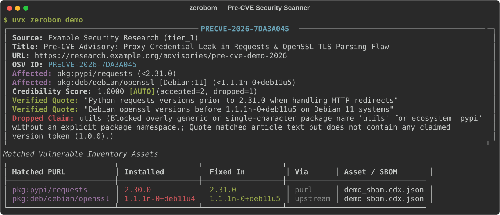
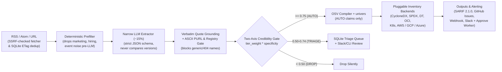

# zerobom

> **Hunt CVE-less and pre-CVE vulnerabilities published in security blogs against your software inventories before NVD or OSV publishes an entry.**

[](https://github.com/zerobom-dev/zerobom/actions/workflows/zerobom-ci.yml)
[](https://zerobom.dev/)
[](LICENSE)
[](https://www.python.org/downloads/)
[](docs/architecture.md)

[](https://pypi.org/project/zerobom/)
[](https://pypi.org/project/zerobom-aws/)
[](https://pypi.org/project/zerobom-gcp/)
[](https://pypi.org/project/zerobom-azure/)

`zerobom` bridges the window between **security blog disclosure** (Google Project Zero, Wiz Research, Trail of Bits, Datadog Security Labs, vendor blogs) and **official CVE/NVD indexing**—isolating the LLM strictly to raw text extraction while keeping quote grounding, package resolution, and version-range matching 100% deterministic.

The LLM is a narrow, replaceable **~15% extraction layer**. Every extracted claim is grounded verbatim in source text, validated against canonical Package URLs and optional package registries, compiled into **OSV 1.6.7-compatible JSON**, and matched deterministically against your CycloneDX, SPDX, container, Kubernetes, or cloud software inventories using [`univers`](https://github.com/aboutcode-org/univers) ecosystem version math.



---

## 60-Second Quickstart (Zero API Keys Required)

Run the wheel-bundled offline demonstration using [`uv`](https://docs.astral.sh/uv/):

```bash
uvx zerobom demo
```

What happens inside `zerobom demo`:

1. Loads a bundled sample advisory naming `requests (<2.31.0)`, `openssl` on Debian 11 (`<1.1.1n-0+deb11u5`), and a noisy `utils` claim.
2. **Grounds quotes verbatim** and blocks the generic unnamespaced `utils` package claim.
3. Compiles **OSV `PRECVE-2026-7DA3A045`** (non-official local deterministic ID prefix) and matches the bundled CycloneDX SBOM via both canonical PURL (`pkg:pypi/requests@2.30.0`) and Debian binary `?upstream=openssl` metadata (`libssl1.1@1.1.1n-0+deb11u4` on `Debian:11`).

### Common Workflows

```bash
# Pure deterministic zero-LLM scan against OSV JSON + CycloneDX/SPDX SBOM
zerobom scan --osv advisories/ --sbom sbom.cdx.json --format sarif > zerobom.sarif

# Check a single security blog advisory URL against your inventory (defaults to local Ollama or ZEROBOM_LLM_*)
zerobom check --url https://research.example.org/post --tier tier_1 --sbom sbom.cdx.json

# Poll curated RSS/Atom/sitemap/HTML feeds with SQLite ETag deduplication
zerobom watch --feeds sources.yaml --sbom ./sboms/ --state-db .zerobom/state.sqlite --format sarif > results.sarif

# List discovered inventory backend plugins
zerobom backends
```

> Configure any OpenAI-compatible LLM endpoint (Ollama, OpenAI, Gemini OpenAI compat, OpenRouter, vLLM) via `ZEROBOM_LLM_BASE_URL`, `ZEROBOM_LLM_MODEL`, and `ZEROBOM_LLM_API_KEY`. Hosted endpoints receive only fetched public blog titles/URLs/text (up to `24` KB); SBOM inventories never leave your host. See [Getting Started](docs/getting-started.md).

---

## Why Not Another LLM Security Wrapper?



- **LLMs never compare versions.** All version ranges (`SemVer`, `PEP 440`, `Maven`, `Go`, `Debian dpkg`, `RPM`, `Alpine`, `Cargo`, `RubyGems`, `NuGet`, `Composer`) execute inside `univers` + OSV `"0"` sentinel range logic. Standard package ecosystems validate against OSV 1.6.7 using the non-official local prefix `PRECVE-YYYY-XXXXXXXX`; `Generic` runtimes and vendor streams such as `CloudLinux` are `zerobom` ecosystem extensions.
- **Verbatim quote grounding.** Every claim must include an exact/normalized `evidence_quote` verified in the fetched article body alongside left/right boundary-checked package and version tokens.
- **No hallucinated packages.** Fuzzy names resolve to canonical ASCII Package URLs (`pkg:pypi/requests`), generic names (`core`, `utils`, `app`) without explicit package namespaces fail closed, and `--verify-registry` confirms existence against PyPI/npm/Maven/Go without following redirects (capping upstream registry lookup errors at `TRIAGE`).
- **Two-axis credibility routing:** `composite_score = source_tier_weight * extraction_specificity`:
  - `>= 0.75` (`AUTO`): Queries SBOM inventory automatically and alerts only when vulnerable hits > 0 (weak quotes, unbounded zero-days, and registry errors are capped `<= 0.70`).
  - `0.50 – 0.74` (`TRIAGE`): Holds in SQLite triage queue / Slack review until human approval.
  - `< 0.50` (`DROP`): Suppresses silently.

### How `zerobom` Fits Alongside Existing Scanners

`zerobom` is an **upstream pre-CVE discovery and OSV compilation feeder**, not a replacement for authoritative CVE scanners:

| Tooling Category | Strength | `T+0` Pre-CVE Blog Window | Relationship with `zerobom` |
| --- | --- | --- | --- |
| **OSV-Scanner / Grype / Trivy** | Fast, authoritative matching against published CVE/GHSA/OSV DBs | Blind until NVD/OSV indexes an advisory | `zerobom` compiles verified blog advisories into OSV JSON for `zerobom scan` or OSV pipelines |
| **OWASP Dependency-Track** | Continuous SBOM lifecycle platform & policy management | Relies on upstream NVD/OSS Index/OSV feeds | Queried directly via built-in `--backend dependency_track` |
| **Dependabot / Renovate** | Automated dependency bump PRs once GitHub Advisory DB updates | No alerts prior to GHSA/CVE publication | `zerobom` alerts SecOps earlier with verbatim blog quotes + fix commits |
| **OpenVEX / CSAF** | Exploitability status & vendor advisory exchange formats | Authoring/exchange standard, not blog discovery | Downstream companion (OpenVEX export planned in `v0.2.0`) |

---

## Benchmark Results

Full methodology, 95% confidence bounds, known blind spots, and per-case breakdowns live in [`benchmarks/REPORT.md`](benchmarks/REPORT.md) (archived `v0.1.0` live run: [`benchmarks/results/live-eval-summary.json`](benchmarks/results/live-eval-summary.json) and [`benchmarks/results/live-eval-report.md`](benchmarks/results/live-eval-report.md)).

| Metric | Tier 1: Offline Deterministic (`16` cases) | Tier 2: Synthetic Dev Suite `gpt-4o-mini` / `v1.4` (`46` cases) |
| --- | ---: | ---: |
| **Routing Accuracy** | **100.00%** (`16/16`) | **97.83%** (`45/46`; CI `[88.66%, 99.62%]`) |
| **Package Precision** | **100.00%** (`12/12`, `0` FP) | **100.00%** (`37/37`, `0` FP; CI `[90.59%, 100%]`) |
| **Package Recall** | **100.00%** (`12/12`, `0` FN) | **97.37%** (`37/38`; CI `[86.51%, 99.53%]`) |
| **Package F1** | **100.00%** | **98.67%** |
| **Version Probe Accuracy** | **100.00%** (`18/18`) | **96.47%** (`82/85`; `82/82` on compiled OSVs) |
| **Quote Grounding Rate** | **84.21%** (`16/19`, adversarial drops) | **97.56%** (`40/41`) |
| **Hallucination Escape Rate** | **0.00%** (`0/16`; 95% CI upper `19.36%`) | **0.00%** (`0/46`; 95% CI upper `7.71%`) |
| **Marketing Trap FP Rate** | **0.00%** (`1/1` marketing trap; `5/5` drops) | **0.00%** (`0/10` leaked; CI `[0%, 27.75%]`) |

> **Scope note:** Tier 2 evaluates `36` concise synthetic historical advisory summaries (`332–584` chars each) + `10` traps across prompt iterations `v1.1`–`v1.4` on `gpt-4o-mini`. Full multi-KB HTML extraction via `trafilatura`, non-English blogs, and semantic negation handling remain active evaluation targets for a held-out corpus in `v0.2.0`.

Reproduce offline CI evals anytime:

```bash
uv run python benchmarks/run_evals.py --mode offline
```

---

## Pluggable Inventory Backends (`zerobom.backends`)

Core `zerobom` has **zero cloud vendor dependencies**. Enterprise & cloud integrations load lazily via standard Python `zerobom.backends` entry points (`zerobom[aws|gcp|azure]` companion cloud packages publish alongside core via `plugins-v*` tags):

### Published Packages (PyPI)

| Distribution | Install Extra | Included Backends | PyPI Status |
| --- | --- | --- | --- |
| [`zerobom`](https://pypi.org/project/zerobom/) | `pip install zerobom` | `local_sbom`, `dependency_track`, `oci_sbom`, `k8s_sbom` | [](https://pypi.org/project/zerobom/) |
| [`zerobom-aws`](https://pypi.org/project/zerobom-aws/) | `pip install "zerobom[aws]"` | `aws_security_hub`, `aws_inspector_sbom`, `s3_sbom` | [](https://pypi.org/project/zerobom-aws/) |
| [`zerobom-gcp`](https://pypi.org/project/zerobom-gcp/) | `pip install "zerobom[gcp]"` | `gcp_artifact_analysis`, `gcs_sbom` | [](https://pypi.org/project/zerobom-gcp/) |
| [`zerobom-azure`](https://pypi.org/project/zerobom-azure/) | `pip install "zerobom[azure]"` | `azure_resource_graph`, `azure_blob_sbom` | [](https://pypi.org/project/zerobom-azure/) |

| Backend Name | Package / Extra | Inventory Source |
| --- | --- | --- |
| `local_sbom` | built-in core | Local CycloneDX (1.4–1.6) & SPDX (2.2–2.3) JSON files/directories |
| `dependency_track` | built-in core | OWASP Dependency-Track `/api/v1/component/identity` API |
| `oci_sbom` | built-in core | OCI registry attached CycloneDX/SPDX SBOMs & in-toto/DSSE attestations |
| `k8s_sbom` | built-in core | Trivy Operator `sbomreports` / `clustersbomreports` CRDs |
| `aws_security_hub` | `zerobom[aws]` | AWS Security Hub `GetSoftwareV2` / `GetSoftwareResourcesV2` |
| `aws_inspector_sbom` | `zerobom[aws]` | Amazon Inspector2 CycloneDX 1.4 / SPDX 2.3 SBOM exports (`report_id` or opt-in export) |
| `s3_sbom` | `zerobom[aws]` | Amazon S3 SBOM prefixes (plain & `.gz`, Glacier skipping) |
| `gcp_artifact_analysis` | `zerobom[gcp]` | GCP Container/Artifact Analysis `PACKAGE` & `SBOM_REFERENCE` occurrences |
| `gcs_sbom` | `zerobom[gcp]` | Google Cloud Storage SBOM prefixes (plain & `.gz`) |
| `azure_resource_graph` | `zerobom[azure]` | Azure Resource Graph `microsoft.security/softwareinventories` |
| `azure_blob_sbom` | `zerobom[azure]` | Azure Blob Storage SBOM prefixes (plain & `.gz`, Archive skipping) |

Want to add a custom inventory backend? Follow [Authoring `zerobom.backends` Inventory Plugins](docs/PLUGIN_AUTHORING.md).

---

## Drop-In GitHub Action & SecOps Alerting

Use [`action.yml`](action.yml) in scheduled CI security scans to upload SARIF to GitHub Code Scanning or sync idempotent GitHub Issues:

```yaml
name: Pre-CVE SBOM Watch
on:
  schedule:
    - cron: "0 */6 * * *"
  workflow_dispatch:

permissions:
  contents: read
  security-events: write
  issues: write

jobs:
  zerobom-watch:
    runs-on: ubuntu-latest
    steps:
      - uses: actions/checkout@11d5960a326750d5838078e36cf38b85af677262 # v4
      - uses: zerobom-dev/zerobom@v0.1.0
        with:
          mode: watch
          sbom: sbom.cdx.json
          upload-sarif: "true"
          create-github-issues: "true"
          llm-base-url: ${{ secrets.ZEROBOM_LLM_BASE_URL }}
          llm-model: ${{ secrets.ZEROBOM_LLM_MODEL }}
          llm-api-key: ${{ secrets.ZEROBOM_LLM_API_KEY }}
```

- **Human-in-the-loop Slack / Webhook Triage:** Run `zerobom triage-worker` (signed HTTP `X-Slack-Signature` callback server or optional Socket Mode with `zerobom[slack]`) alongside `zerobom triage list|show|approve|reject`. See [Alerting & Triage](docs/alerting-and-triage.md).

---

## Documentation & Community

- **Documentation:** [Getting Started](docs/getting-started.md) · [Architecture & Security](docs/architecture.md) · [Backends](docs/backends.md) · [Alerting & Triage](docs/alerting-and-triage.md) · [GitHub Action](docs/github-action.md) · [Benchmarks](docs/benchmarks.md) · [Plugin Authoring](docs/PLUGIN_AUTHORING.md)
- **Contribute in 1 Minute:** Add a security blog to [`sources.yaml`](sources.yaml), submit a benchmark fixture, or contribute a backend plugin—see [`CONTRIBUTING.md`](CONTRIBUTING.md).
- **Security Policy:** See [`SECURITY.md`](SECURITY.md) for responsible disclosure and security boundaries.
- **License:** [Apache-2.0](LICENSE)
