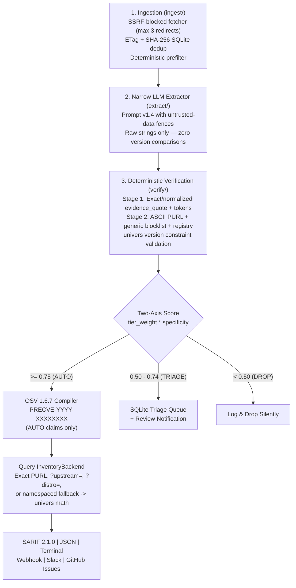

# Architecture & Security Boundaries

`zerobom` treats all fetched blog HTML, RSS/XML feeds, SBOM payloads, package names, version strings, and LLM responses as **untrusted adversarial input**.

## End-to-End Verification Pipeline

## Non-Negotiable Engineering Invariants

1. **Deterministic version math:** Version comparisons never happen in prompts. [`parse_version_constraint`](api/verify.md) and [`is_version_affected`](api/verify.md) compile constraints into OSV 1.6.7-compatible ranges (`introduced`, `fixed`, `last_affected`) with `"0"` sentinel semantics evaluated by `univers`, using the explicit non-official local prefix `PRECVE-YYYY-XXXXXXXX` (`Generic` and `CloudLinux` are documented `zerobom` ecosystem extensions outside the strict OSV 1.6.7 enum).
2. **Release-stream & upstream source matching:** Container and OS advisories (e.g., `Debian:11`, `Ubuntu:22.04`, `CloudLinux:9`, `Alpine:v3.19`) filter strictly against `?distro=` PURL qualifiers and resolve Debian/RPM binary packages via `?upstream=` source-package metadata.
3. **Fail-closed grounding & credibility caps:** If a claimed `evidence_quote` is missing from the article text, fails left/right token boundaries, spans prose negation, or omits required package/version tokens, extraction specificity is capped below `0.75` (or dropped `< 0.50`). Unbounded zero-days, invalid version bounds, and upstream registry `ERROR` failures also cap `<= 0.70` (`TRIAGE`), and `TRIAGE` claims cannot piggyback into an `AUTO` OSV advisory.
4. **Blocklist against generic hallucinations:** Bare generic package names (`utils`, `core`, `app`, etc.) and non-ASCII lookalikes are blocked across package registries, `pkg:generic/*` namespaces, and untyped fallback matching unless explicitly qualified with a real package namespace (e.g., `com.acme:utils`).

## Security & Injection Defenses

- **SSRF & Proxy Defense:** [`SafeHttpFetcher`](api/ingest.md), webhook delivery, Slack senders, registry lookups, and OCI blob redirects resolve DNS through pluggable resolvers, reject private/loopback/link-local/IMDS (`169.254.169.254`) and multicast IPs, disable implicit proxy env inheritance (`trust_env=False`), disable automatic redirects on metadata/registry lookups, and cap hop count (`<= 3`) and response bytes before JSON/XML parsing. (Deploy behind a network-layer egress firewall/proxy until pinned-IP socket transport lands in `v0.2.0`.)
- **Query & Registry Injection Safety:** Maven Central Solr searches, GCP Artifact Analysis CEL filters (`dependencyPackageName`, `resourceUrl`), and Azure Resource Graph KQL queries validate ASCII package identifiers against strict character allowlists and fail closed rather than broadening filters on unsafe strings.
- **Serialization & Output Escaping:** All SQLite state and triage queries use parameterized `?` placeholders; YAML feeds use `yaml.safe_load`; XML feeds reject DOCTYPE/ENTITY declarations across encodings via `expat` pre-scanning; JSON loaders guard against `RecursionError`; Rich terminal output wraps untrusted strings in `rich.text.Text` and strips ANSI/OSC-8 and C0/C1 control sequences; Slack escapes `<`, `>`, `&` and strips backticks; GitHub Issues escape HTML comments, `<!-- zerobom:advisory-id:... -->` spoofing markers, Markdown images, and `@mentions`.
- **No Runtime `assert` Reliance:** All boundary validations raise typed domain exceptions (`FetchError`, `BackendError`, `TriageError`, `GitHubIssueError`, `AlertDeliveryError`) so checks remain active even under `python -O`.
