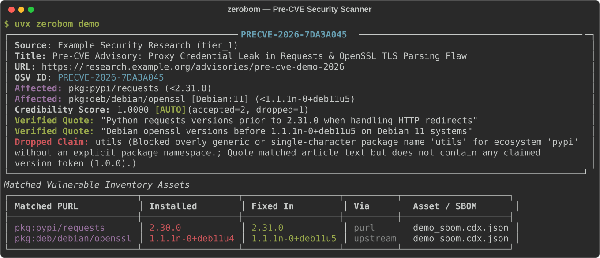

# zerobom Documentation

`zerobom` hunts **CVE-less and pre-CVE vulnerabilities** disclosed in security research blogs against CycloneDX, SPDX, container, Kubernetes, and cloud software inventories—days or weeks before NVD or OSV assigns an entry.

## Core Engineering Guarantees

1. **LLMs never compare versions.** Extraction outputs raw strings only; all range checks execute deterministically using [`univers`](https://github.com/aboutcode-org/univers) and OSV `"0"` sentinel range logic.
2. **Verbatim quote grounding.** Every claim must carry an `evidence_quote` verified directly in the fetched article body alongside package and version token checks.
3. **No hallucinated packages.** Claims resolve to canonical ASCII `pkg:` Package URLs, block unnamespaced and `pkg:generic/` generic names (`utils`, `core`, `app`), and optionally validate against upstream PyPI, npm, Maven, or Go registries (capping errors at `TRIAGE`).
4. **Standard interchange outputs only.** Verified findings compile to **OSV 1.6.7-compatible JSON** (non-official local prefix `PRECVE-YYYY-XXXXXXXX`, with `Generic`/`CloudLinux` documented as `zerobom` extensions) and export to **SARIF 2.1.0**, Rich terminal tables, JSON, signed webhooks, Slack Block Kit, and idempotent GitHub Issues.
5. **Cloud-agnostic core + pluggable backends.** Core depends on zero cloud SDKs. Ten built-in and optional backends share the identical query-driven [`InventoryBackend`](api/backends.md) contract.

## Where to Start

- New to `zerobom`? Run `uvx zerobom demo` and follow [Getting Started](getting-started.md).
- Inspecting our verification invariants and threat model? Read [Architecture & Security](architecture.md).
- Integrating Dependency-Track, OCI registries, Kubernetes, AWS, GCP, or Azure? See [Inventory Backends](backends.md).
- Setting up CI or Slack approval buttons? Check [GitHub Action & CI](github-action.md) and [Alerting & Human Triage](alerting-and-triage.md).
